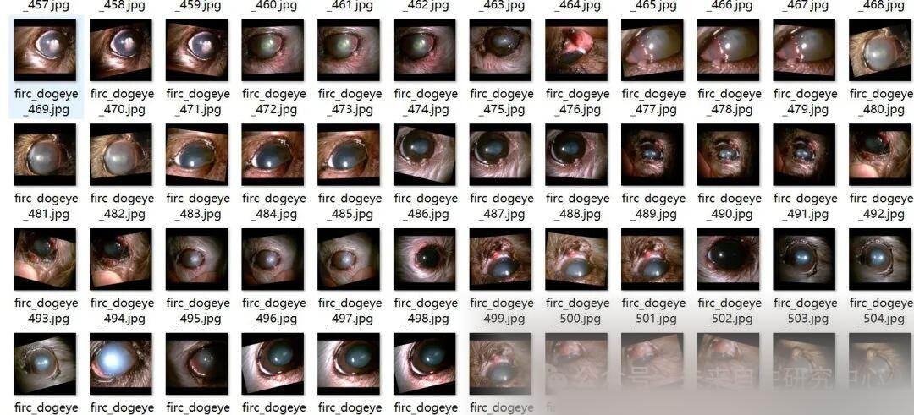
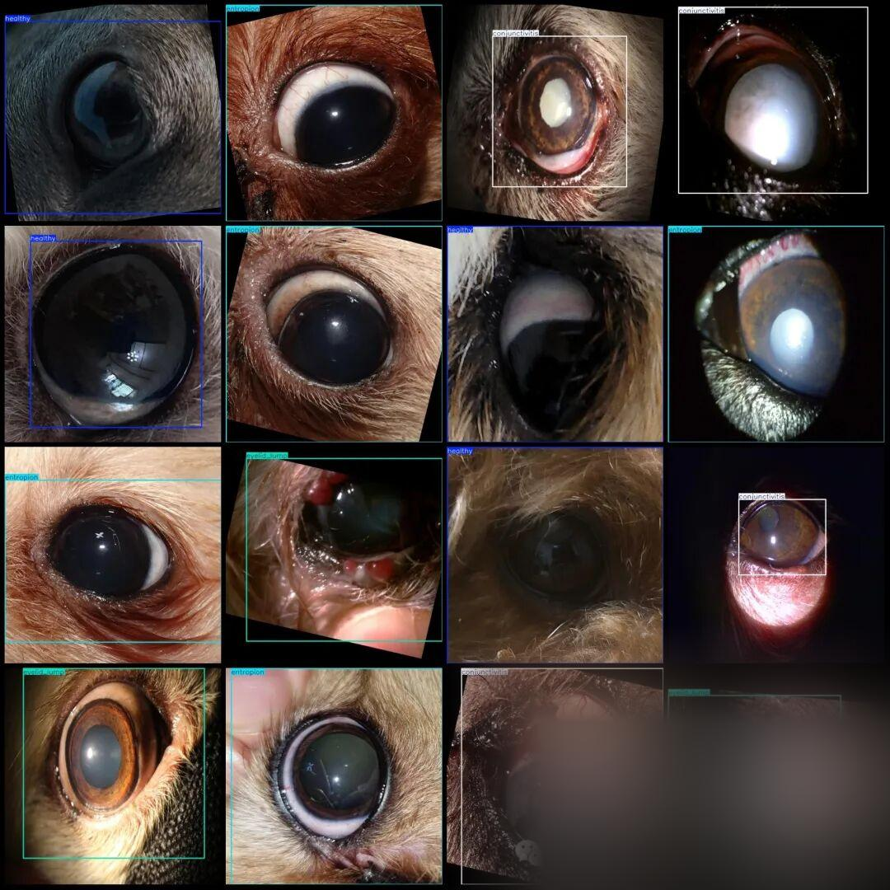

# Dog Eye Disease Detection Dataset VOC+YOLO format with 6364 images in 4 categories with enhanced features

Approximately one-third of the dataset consists of original images, with the remaining being enhanced images. For a detailed look at the image previews, please refer to the specific instructions.

Dataset format: Pascal VOC format + YOLO format (txt file without split path, only containing jpg images and corresponding VOC format xml files and yolo format txt files)

Number of images (number of jpg files): 6364

Number of annotations (number of xml files): 6364

Number of annotations (number of txt files): 6364

Labeling category count: 4

Label category names (Note that the order of yolo format categories does not correspond to this, but is based on the classes.txt in the labels folder): ["conjunctivitis", "entropion", "eyelid_lump", "healthy"]

Number of boxes labeled in each category:

conjunctivitis Frames = 1672

Entropy Frames = 1662

Eyelid_lump frame count = 1700

Healthy Frames = 1332

Total frame count: 6366

Using labelImg:

Annotation rules: Draw a rectangle around the category.

Important Notice: No

Special : This dataset does not guarantee the accuracy or precision of the trained models or weight files. The dataset is provided with accurate and reasonable annotations only.

Image Preview:

Annotation example:

## Payment

Here is a pay link on Stripe ( https://buy.stripe.com/3cs8yP7sY87d0vu9AB ). Please contact me lonlonago@foxmail.com after funding $89, and I will send you a complete data files , thank you!

